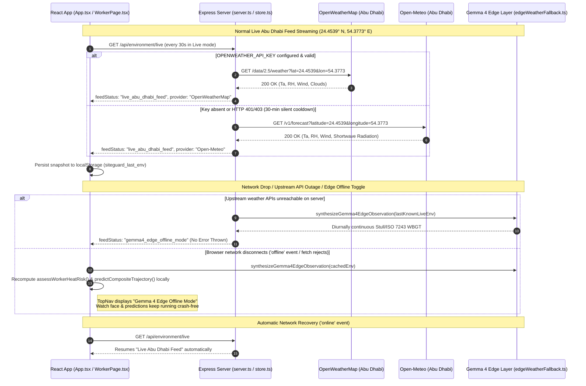

# SiteGuard — Climate-Resilient Worker Health & Edge AI Safety Platform

[](tsconfig.json)
[](package.json)
[](server.ts)
[](TESTING.md)
[](#)

**Team:** GenOS Team  
**Challenge:** Future Health Digital Innovation Challenge (Abu Dhabi) — Challenge Statement 07: *Climate-Resilient Worker Health*

**SiteGuard** is a device-agnostic, privacy-enforced industrial heat-strain early-warning and UAE regulatory compliance platform. It fuses real-time Abu Dhabi meteorological telemetry (`24.4539° N, 54.3773° E`), hardware-agnostic wearable BLE biometrics, deterministic physiological forecasting, **Gemma 4 Edge Offline Resilience**, multilingual voice incident intake, and automated **UAE Ministerial Resolution No. 44 (12:30–15:00 GST Midday Break)** compliance reporting.

---

## Table of Contents

1. [System Architecture Diagram](#system-architecture-diagram)
2. [Real-Time Weather & Edge Offline Failover Flow](#real-time-weather--edge-offline-failover-flow)
3. [Repository File Tree & Module Flow Map](#repository-file-tree--module-flow-map)
4. [REST API Reference](#rest-api-reference)
5. [Core Capabilities & User Workflows](#core-capabilities--user-workflows)
6. [Physiological & Environmental Models](#physiological--environmental-models)
7. [Responsible AI Safeguards & Privacy Boundaries](#responsible-ai-safeguards--privacy-boundaries)
8. [Local Setup, Environment & Verification](#local-setup-environment--verification)
9. [Known Limitations & Hardware Deployment Path](#known-limitations--hardware-deployment-path)

---

## System Architecture Diagram

```mermaid
flowchart TB
    %% ── Layer 1: Environmental Telemetry & Resilience ───────────────────────
    subgraph ENV["1. Environmental Telemetry & Edge Resilience Layer"]
        OWM["OpenWeatherMap API<br/>(Optional OPENWEATHER_API_KEY)<br/>24.4539°N, 54.3773°E"]
        OM["Open-Meteo Live API<br/>(Keyless Primary/Fallback)<br/>Ta, RH, Wind, Solar Radiation"]
        CSV["Historical Abu Dhabi CSV<br/>data/uae_heatwave_abu_dhabi.csv<br/>14-Hour Heatwave Curve"]
        EDGE_SRV["Gemma 4 Edge Fallback Engine<br/>src/shared/edgeWeatherFallback.ts<br/>Diurnal Continuity + Cached Anchor"]

        OWM -- "HTTP 401/403 Cooldown<br/>or Timeout" --> OM
        OM -- "Network Drop / API Failure" --> EDGE_SRV
    end

    %% ── Layer 2: Hardware & Client Inputs ───────────────────────────────────
    subgraph INPUTS["2. Wearable & Worker Field Inputs"]
        BLE["Physical BLE Gateway OR<br/>UI Wearable Simulator<br/>POST /api/ble/telemetry"]
        MIC["Browser Microphone / MediaRecorder<br/>+ Severity Selector (Low/Med/High)<br/>POST /api/worker/:id/voice-report"]
        POLICY["Supervisor Custom WBGT Rules<br/>& Multilingual Overrides<br/>PUT /api/supervisor/alert-policy"]
    end

    %% ── Layer 3: Express + Deterministic Engines ────────────────────────────
    subgraph CORE["3. Express Server (server.ts) & Pure Deterministic Engines"]
        STORE["In-Memory & Policy Store<br/>src/server/store.ts"]
        RISK["Risk Assessment Engine<br/>src/shared/riskEngine.ts<br/>Moran PSI + ACGIH WBGT + PPE CAF"]
        FORE["Trajectory Forecast Engine<br/>src/shared/forecastEngine.ts<br/>Weighted Damped Trend + 90% CI<br/>+ Lagged Ridge Ablation"]
        WBGT["Psychrometric WBGT Engine<br/>src/shared/uaeWeatherData.ts<br/>Stull Tw + ISO 7243 Tg"]
        GEMINI["Server-Side Gemini Service<br/>src/server/geminiService.ts<br/>Explain, Translate (5 Langs),<br/>Transcribe, Narrative, ETA Guard"]

        STORE <--> RISK
        STORE <--> FORE
        STORE <--> WBGT
        STORE <--> GEMINI
    end

    ENV --> STORE
    INPUTS --> STORE

    %% ── Layer 4: Privacy Boundary & Client Views ────────────────────────────
    subgraph PRIVACY["4. API Privacy Boundary & Isomorphic Browser Edge Layer"]
        SELF_API["GET /api/worker/:id/state<br/>(HTTP 403 if Supervisor Role)"]
        SUP_API["GET /api/supervisor/crew<br/>WorkerStatusPublic DTO<br/>(Zero Raw Vitals Serialized)"]
        COMP_API["GET /api/compliance/report<br/>UAE 12:30-15:00 GST Audit"]
        CLIENT_EDGE["Browser Edge Continuity<br/>localStorage Cache + Online/Offline<br/>Recomputes riskEngine & forecastEngine"]
    end

    STORE --> SELF_API
    STORE --> SUP_API
    STORE --> COMP_API

    subgraph UI["5. React 19 + Tailwind CSS Frontend (src/App.tsx)"]
        TOP["TopNav Feed Status Indicator<br/>Live Abu Dhabi Feed | Gemma 4 Edge Offline Mode | Historical Calibration"]
        W_PAGE["/worker — Circular WatchFaceGauge + AOD Mode<br/>Multilingual Alerts (en/hi/ur/bn/tl) + Voice Intake"]
        S_PAGE["/supervisor — Privacy-Safe Crew Grid<br/>Threshold Editor + Break/Rotation Dispatch"]
        C_PAGE["/compliance — UAE Midday Break Ledger<br/>PDF Print & Regulator JSON Export"]
        V_PAGE["/validation & /forecast-validation<br/>Sensitivity, Lead Time & MAE/RMSE Ablation"]
    end

    SELF_API --> W_PAGE
    SUP_API --> S_PAGE
    COMP_API --> C_PAGE
    CLIENT_EDGE -. "Offline Failover" .-> W_PAGE
    CLIENT_EDGE -. "Offline Failover" .-> S_PAGE
    TOP --> W_PAGE
    TOP --> S_PAGE
```



---

## Real-Time Weather & Edge Offline Failover Flow



---

## Repository File Tree & Module Flow Map

```text
siteguard/
├── .env.example                        # Env var schema (GEMINI_API_KEY, APP_URL, optional OPENWEATHER_API_KEY)
├── .github/
│   └── workflows/                      # CI automation workflows
├── DEMO_SCRIPT.md                      # Live 3-minute hackathon walkthrough & step-by-step talking points
├── README.md                           # Architecture, file flow, formulas, API reference, and setup guide
├── TECHNICAL_DOCS.md                   # Extended technical deep-dive documentation
├── TESTING.md                          # Automated testing matrix & verification instructions
├── index.html                          # Vite HTML entry point & SEO/OpenGraph metadata
├── metadata.json                       # App identity ("SiteGuard"), mic permission, server Gemini capability
├── package.json                        # Scripts (dev, start, build, lint, test:unit, test:e2e, test)
├── playwright.config.ts                # Chromium E2E configuration targeting http://127.0.0.1:3000
├── vitest.config.ts                    # Unit test runner configuration
├── tsconfig.json                       # Strict TypeScript compiler config
├── vite.config.ts                      # Vite + React + Tailwind v4 plugin configuration
├── server.ts                           # Express API server + Vite dev middleware / prod static serving
│
├── data/
│   └── uae_heatwave_abu_dhabi.csv      # Bundled August Abu Dhabi Mussafah hourly heatwave dataset (06:00-19:00 GST)
│
├── fixtures/
│   ├── forecast_trend_fixtures.json    # Known slope & crossing ETA verification cases
│   ├── historical_wbgt_day.json        # Reference hourly WBGT psychrometric values
│   ├── psi_reference_pairs.json        # Moran et al. (1998) PSI & tier cutoff reference vectors
│   └── synthetic_cohort_fixture.json   # Calibrated multi-worker heat-strain validation trajectories
│
├── src/
│   ├── main.tsx                        # React 19 DOM root mount
│   ├── index.css                       # Global Tailwind CSS v4 styles & slider styling
│   ├── App.tsx                         # Router, °C/°F unit state, 30s live weather polling, online/offline edge sync
│   │
│   ├── components/
│   │   ├── TopNav.tsx                  # Header nav, Live/Edge Offline/CSV status pill, °C/°F toggle, GST hour picker
│   │   ├── WatchFaceGauge.tsx          # Primary 240° radial safety dial, ghost forecast needle, 5 history ticks, monochrome AOD
│   │   ├── VoiceIncidentRecorder.tsx   # Pre-transcription Low/Med/High severity dropdown + MediaRecorder + Web Speech fallback
│   │   ├── TemperatureThresholdEditor.tsx # Supervisor WBGT threshold editor + 5-language custom alert message configurator
│   │   ├── SparklineChart.tsx          # Dark/light historical + projected trajectory chart with 90% CI band
│   │   └── DemoDrawer.tsx              # Slide-over hackathon demo script & quick-reference drawer
│   │
│   ├── pages/
│   │   ├── WorkerPage.tsx              # /worker: WatchFaceGauge, Check-In SOS, Voice Report, Forecast, BLE Simulator drawer
│   │   ├── SupervisorPage.tsx          # /supervisor: Privacy-safe crew status grid, break queue, rotations, threshold editor
│   │   ├── CompliancePage.tsx          # /compliance: UAE 12:30-15:00 GST break audit, Gemini narrative, JSON/PDF export
│   │   ├── ValidationPage.tsx          # /validation: Sensitivity, specificity, FAR, F1 & lead-time backtest dashboard
│   │   └── ForecastValidationPage.tsx  # /forecast-validation: t+15 / t+30 MAE, RMSE & Ridge ablation comparison
│   │
│   ├── shared/                         # Isomorphic pure TypeScript modules shared by Server, Browser Edge & Tests
│   │   ├── types.ts                    # Shared DTOs (WorkerStateSelf, WorkerStatusPublic privacy contract, Policy, Env)
│   │   ├── temperature.ts              # °C <-> °F conversion & text formatting helpers
│   │   ├── uaeWeatherData.ts           # CSV heatwave curve, Stull (2011) wet-bulb, ISO 7243 globe & WBGT, UAE Midday Break
│   │   ├── edgeWeatherFallback.ts      # Abu Dhabi solar geometry & Gemma 4 Edge Offline thermal synthesis
│   │   ├── riskEngine.ts               # Pure Moran PSI, Tanaka HRmax, ACGIH TLV/CAF, env-only fault degradation
│   │   ├── forecastEngine.ts           # Weighted damped trend, 90% CI, cold-start/fault guard, lagged Ridge model
│   │   └── cohortAndValidation.ts      # Deterministic synthetic cohort generator, backtest runner & ablation evaluator
│   │
│   └── server/
│       ├── store.ts                    # Central crew state, weather API failover + OWM 401 cooldown, custom policy & reset
│       └── geminiService.ts            # Gemini AI explainability, 5-lang translation, ETA hallucination guard, voice STT, 30s breaker
│
└── tests/
    ├── unit/
    │   ├── edge-resilience.unit.spec.ts    # Abu Dhabi coordinates, solar curve & Gemma 4 Edge fallback continuity tests
    │   ├── predictive-forecast.unit.spec.ts # Slope/CI math, cold-start guard, 5-lang ETA hallucination guard tests
    │   ├── risk-engine.unit.spec.ts        # Moran PSI reference pairs, exact tier cutoffs & fault degradation tests
    │   └── validation-backtest.spec.ts     # Backtest sensitivity, specificity & forecast validation metric bounds
    └── e2e/
        ├── access-control.spec.ts          # Enforces zero raw vitals leak in /supervisor DOM & HTTP 403 on worker endpoint
        ├── compliance-report.spec.ts       # Break audit JSON download, PDF print trigger & zero-violation handling
        ├── e2e-demo-smoke.spec.ts          # Full end-to-end demo script replay + screenshot capture
        ├── edge-resilience.spec.ts         # Live Abu Dhabi Feed -> Edge Offline toggle -> context.setOffline(true) -> online recovery
        ├── fault-injection.spec.ts         # BLE disconnect, low battery, sensor noise & GPS loss graceful degradation
        ├── forecast-validation.spec.ts     # Validates rendered MAE/RMSE & ablation table against engine output
        ├── supervisor-thresholds.spec.ts   # °C/°F threshold conversion, ordering guard & cross-page custom Hindi alert
        ├── validation-backtest.spec.ts     # Validates rendered backtest metrics against deterministic baseline
        ├── watchface-and-voice.spec.ts     # WatchFaceGauge, AOD mode, zero ghost needle on insufficient data & voice intake
        └── worker-flow.spec.ts             # Green/Amber/Red sliders, 5-lang RTL/LTR switching, I'm Okay/Need Help & °C/°F toggle
```

---

## REST API Reference

| Endpoint | Method | Purpose & Privacy Rules | Source Module |
| :--- | :--- | :--- | :--- |
| `/api/environment` | `GET` | Returns current environmental observation & 14-hour Abu Dhabi heatwave curve | `server.ts` |
| `/api/environment/live` | `GET` | Queries Live Abu Dhabi Feed (OpenWeatherMap → Open-Meteo → Gemma 4 Edge fallback); accepts `?simulateOffline=true\|false` | `server.ts`, `store.ts` |
| `/api/environment/mode` | `POST` | Switches between `live_abu_dhabi`, `historical_heatwave` (`hourGst`), or `simulateOffline` | `server.ts`, `store.ts` |
| `/api/workers` | `GET` | Lists monitored worker IDs, roles, and zones | `server.ts` |
| `/api/worker/:id/state` | `GET` | Returns full `WorkerStateSelf` (watch dial, guidance, forecast); returns **`HTTP 403`** if called with supervisor role headers/query | `server.ts`, `store.ts` |
| `/api/ble/telemetry` | `POST` | Hardware-agnostic BLE ingestion contract (`BLETelemetryFrame`) used by both simulator & physical BLE gateways | `server.ts`, `store.ts` |
| `/api/worker/:id/fault` | `POST` | Injects or clears `bleDisconnected`, `lowBattery`, `sensorNoise`, `gpsLoss` | `server.ts`, `store.ts` |
| `/api/worker/:id/language` | `POST` | Updates worker preferred language (`en`, `hi`, `ur`, `bn`, `tl`) and translates guidance | `server.ts`, `geminiService.ts` |
| `/api/worker/:id/checkin` | `POST` | Records `"I'm Okay"` (hydration credit / SOS clear) or `"Need Help"` (immediate supervisor SOS alert) | `server.ts`, `store.ts` |
| `/api/worker/:id/voice-report` | `POST` | Accepts recorded audio (`audioBase64` + `mimeType`) or spoken/typed note with pre-selected `severity` (`Low`/`Medium`/`High`), transcribes via Gemini, and logs privacy-safe alert | `server.ts`, `geminiService.ts` |
| `/api/worker/:id/sim-step` | `POST` | Advances simulated shift clock (`step_3m`, `step_6m`, `reset_cool`) for live forecast demonstrations | `server.ts`, `store.ts` |
| `/api/supervisor/crew` | `GET` | Returns `WorkerStatusPublic[]` crew snapshot with **zero raw vitals** (`hrBpm`, `skinTempC`, `exertionIndex`, `hr0`, `tc0` stripped at API projection) | `server.ts`, `store.ts` |
| `/api/supervisor/action` | `POST` | Dispatches `acknowledge`, `order_break`, `escalate`, or `apply_rotation` | `server.ts`, `store.ts` |
| `/api/supervisor/alert-policy` | `GET` / `PUT` | Reads or updates custom WBGT Amber/Red alert thresholds and multilingual worker alert copy | `server.ts`, `store.ts` |
| `/api/compliance/report` | `GET` | Generates UAE Ministerial Resolution No. 44 (12:30–15:00 GST) break & incident compliance report | `server.ts`, `store.ts` |
| `/api/compliance/narrative` | `POST` | Synthesizes plain-language regulator narrative summary via Gemini with template fallback | `server.ts`, `geminiService.ts` |
| `/api/validation/backtest` | `GET` | Runs historical backtest sensitivity, specificity, false-alarm rate, and lead time metrics | `server.ts`, `cohortAndValidation.ts` |
| `/api/validation/forecast` | `GET` | Runs `t+15m` / `t+30m` MAE, RMSE, CI coverage & Lagged Ridge ablation comparison | `server.ts`, `cohortAndValidation.ts` |
| `/api/validation/generate-cohort` | `POST` | Rebuilds deterministic calibrated or Gemini-synthesized physiological validation cohorts | `server.ts`, `geminiService.ts` |
| `/api/system/reset` | `POST` | Resets demo scenario (`default` or `zero_violations`) cleanly to `11:00 GST` baseline | `server.ts`, `store.ts` |

---

## Core Capabilities & User Workflows

- **Circular Watch Face HUD (`/worker`)**:
  - Primary 240° radial gauge (`WatchFaceGauge.tsx`) with Green (`0–3.9`), Amber (`4.0–6.9`), and Red (`7.0–10.0`) arcs, real-time composite strain needle, `t+15m` ghost trajectory needle, 5 historical sample ticks, and a dedicated **Always-On Display (AOD)** monochrome variant (`Simulate AOD`).
  - Strict safety boundary: removes the ghost needle completely when `forecast.status === 'insufficient_trend_data'` and switches to desaturated slate styling on BLE/sensor faults.
- **Voice Incident Recording with Pre-Transcription Severity (`/worker`)**:
  - `VoiceIncidentRecorder.tsx` lets workers select incident severity (**Low**, **Medium**, **High**) *before* capturing audio via `MediaRecorder` + Web Speech live preview (or fallback text), transcribing server-side via Gemini and dispatching a privacy-safe alert directly to `/supervisor`.
- **Multilingual Safety Alerts & Global `°C` / `°F` Toggle**:
  - Instant switching across **English (`en`)**, **Hindi (`hi`)**, **Urdu (`ur`, full RTL layout)**, **Bengali (`bn`)**, and **Tagalog (`tl`)**.
  - Persistent global Celsius / Fahrenheit unit switch across all environmental readouts, skin temperatures, thresholds, and compliance/alert copy.
- **Supervisor Temperature Thresholds & Multilingual Rules (`/supervisor`)**:
  - `TemperatureThresholdEditor.tsx` enables site supervisors to customize Effective WBGT Amber & Red Stop-Work cutoffs (with ordering validation) and author custom per-language alert headlines and instructions pushed immediately to workers.
- **Live Abu Dhabi Feed & Gemma 4 Edge Offline Mode (`TopNav.tsx`)**:
  - Top bar shows **`Live Abu Dhabi Feed`**, **`Gemma 4 Edge Offline Mode`**, or **`Historical Calibration`**, with a 1-click **`Edge Offline`** toggle for live hackathon demonstrations and automatic recovery when connectivity returns.

---

## Physiological & Environmental Models

### 1. Moran Physiological Strain Index (PSI)
**Citation:** Moran, D. S., Shitzer, A., & Pandolf, K. B. (1998). *A physiological strain index to evaluate heat stress.* *American Journal of Physiology*, 275(1), R129–R134.

$$\text{PSI} = 5 \cdot \frac{\text{HR}_t - \text{HR}_0}{\text{HR}_{\max} - \text{HR}_0} + 5 \cdot \frac{T_{c,t} - T_{c,0}}{39.5 - T_{c,0}}$$

- **$\text{HR}_{\max}$** via Tanaka et al. (2001): $208 - 0.7 \times \text{ageYears}$.
- **Core-Temp Proxy ($T_{c,\text{proxy}}$):** $36.8 + (\text{skinTempC} - 33.5) \times 0.68$ (clamped `36.2°C–40.5°C`).
- Combined with **ACGIH WBGT TLV / Action Limits** (adjusted by PPE Clothing Adjustment Factor: `Standard +0°C`, `FR/Arc-Flash +2°C`, `Chemical/Tyvek +4°C` and worker acclimatization days `< 7d` vs `≥ 7d`) into a `0–10` composite score: **Green (`0–3.9`)**, **Amber (`4.0–6.9`)**, **Red (`7.0–10.0`)**.

### 2. Outdoor WBGT Psychrometrics
- **Wet-Bulb Temperature ($T_w$):** Stull (2011) empirical formula from air temperature $T_a$ and relative humidity $\text{RH}$.
- **Black-Globe Temperature ($T_g$):** Derived from air temperature, wind speed ($m/s$), and solar irradiance ($W/m^2$ — observed from Open-Meteo or estimated via Abu Dhabi GST solar geometry + cloud cover for OpenWeatherMap).
- **ISO 7243 Outdoor WBGT:** $\text{WBGT} = 0.7\,T_w + 0.2\,T_g + 0.1\,T_a$.

---

## Responsible AI Safeguards & Privacy Boundaries

SiteGuard enforces strict architectural separation between **deterministic safety math** and **LLM communication**:

1. **Zero LLM Numeric Scoring or Forecasting:** All Moran PSI, WBGT, risk tiers, and `t+15`/`t+30` projections are computed strictly by pure deterministic TypeScript engines (`src/shared/riskEngine.ts`, `src/shared/forecastEngine.ts`). Gemini only translates, summarizes, transcribes audio, and contextualizes pre-computed structured outputs.
2. **Server-Side Forecast ETA Hallucination Guard (`enforceDeterministicForecastEtaGuard`):** Normalizes Unicode numerals across all 5 supported languages (`en`, `hi`, `ur`, `bn`, `tl`), validates every minute-based ETA claim against deterministic `projectedAmberCrossingMin` and `projectedRedCrossingMin` (`±2 min` tolerance), and strips any fabricated ETAs when crossings are `null` or `status === 'insufficient_trend_data'`.
3. **Transient Timeout & Circuit Breaker:** Gemini calls enforce an `8s` request timeout and `30s` transient cooldown fallback (`buildDeterministicFallback`) so upstream LLM latency never blocks wearable alerts.
4. **API-Layer Worker Privacy Boundary:** Supervisor routes (`/api/supervisor/*`) serialize only `WorkerStatusPublic` risk bands, forecasts, and actions—never `hrBpm`, `skinTempC`, `exertionIndex`, `hr0`, or `tc0`. Requests to `/api/worker/:id/state` carrying supervisor credentials fail with `HTTP 403`.

---

## Local Setup, Environment & Verification

### Prerequisites
- Node.js 20+ and npm (Playwright Chromium installed via `npx playwright install chromium` for E2E tests)

### Environment Variables (`.env.example`)
| Variable | Required | Description |
| :--- | :---: | :--- |
| `GEMINI_API_KEY` | Recommended | Enables Gemini multilingual alert copy, compliance narratives, voice audio transcription, and synthetic cohort generation (falls back cleanly to deterministic templates when absent). |
| `OPENWEATHER_API_KEY` | Optional | Enables OpenWeatherMap Abu Dhabi station queries; omitted/invalid/401 keys automatically trigger a silent 30-min cooldown and route live streaming through keyless Open-Meteo + Gemma 4 Edge fallback. |
| `APP_URL` | Optional | Runtime deployment base URL. |

### Run & Test Commands

```bash
# 1. Install dependencies
npm install

# 2. Start full-stack Express + Vite development server on port 3000
npm run dev

# 3. TypeScript check & production build
npm run lint
npm run build

# 4. Run full verification suite (tsc --noEmit + Vitest unit + Playwright E2E)
npm test
```

---

## Known Limitations & Hardware Deployment Path

### Known Limitations
1. **Skin-to-Core Proxy:** Non-invasive wrist/chest skin thermistors are sensitive to solar load and PPE microclimate; `Tc_proxy` is documented as an approximation until dual-heat-flux or core sensors are paired.
2. **Synthetic Validation Cohort:** Backtest sensitivity, false-alarm rate, lead time, and prospective MAE/RMSE are evaluated on synthetic trajectories calibrated to ACGIH/NIOSH thresholds rather than IRB clinical trials.
3. **Environment-Only Fault Fallback Precision:** On BLE disconnect, `<10%` battery, or high sensor noise, physiological streams are isolated and scoring conservatively uses ACGIH WBGT + PPE limits alone.
4. **Cold-Start / Post-Fault Forecast Guard:** At least 4 clean contiguous samples (`~10–15 min`) are required before issuing `t+15`/`t+30` projections.

### Path to Physical BLE Wearables
Connecting physical wearables requires **zero UI or Risk Engine changes**:
1. Run a BLE-to-HTTPS gateway (ruggedized mobile app or ESP32/Raspberry Pi LoRa-BLE bridge) reading Bluetooth SIG Heart Rate (`0x180D`), Health Thermometer (`0x1809`), and Battery (`0x180F`).
2. `POST` GATT payloads matching `BLETelemetryFrame` directly to `/api/ble/telemetry`.
3. Map pseudonymized device tokens inside a secure worker identity vault outside supervisor-accessible routes.
